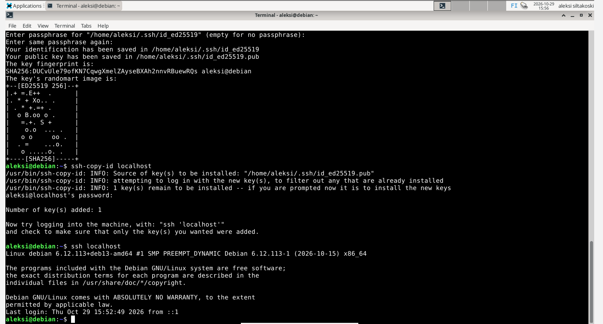

# H1-Hei-Ansiblen-Maailma

## Tehtävänä oli asentaa SSH-demoni ja katsoa että se toimii. Tämän jälkeen automatisoida SSH-kirjautuminen julkisella avaimella. Ja tämän jälkeen tehdä hei maailma ansiblella.

## SSH-demonin lataus
Ensiksi kirjauduin sudo-käyttäjälleni komennolla "Sudo whoami", jonka jälkeen syötin salasanani ja olin sudo-käyttäjälläni kirjautuneena. 
Ajoin uusimmat päivitykset komennolla "sudo apt-get update". 
Latasin sitten SSH:n komennolla "sudo apt-get -y install ssh". 
Seuraavaksi laitoin komennon "sudo systemctl enable --now ssh". Tämä komento teki sen, että SSH-demoni käynnistyy aina virtuaalikoneen käynnistyessä ja se laitettiin myös samalla hetkellä päälle.
Nyt ssh-demoni on ladattu ja asetettu käynnistymään aina virtuaalikoneen käynnistymisen yhteydessä

## SSH-demonin testaus
Aloitin laittamalla komennon "ssh localhost" virtuaalikoneen terminaaliin. 
Tämän jälkeen laitoin terminaalin komento riville "w" ja näin, että olin kirjautuneena kaksi kertaa. Toinen on läppärini ja toinen SSH:n kautta muodostettu yhteys.
Terminaaliin laitoin komennon "exit" ja toinen yhteyksistä disconnectasi
Seuraavaksi generoin keypair:in komennolla "ssh-keygen". Tässä vaiheessa terminaalissa piti painaa 3 kertaa enteriä, mikä hyväksyi kaikki oletusasetukset. 
Sitten juuri tehty keypair kopioitiin localhostiin komennolla "ssh-copy-id localhost". Tämän jälkeen tuli salasana antaa vielä viimeisen kerran. Kyseinen komento lisäsi public key:n ssh/authorized_keys ja nyt kirjautuminen onnistuu SSH:n kautta ilman salasanaa.
Seuraavaksi kirjoitin virtuaalikoneen terminaaliin komennon: "ssh localhost" ja pystyin kirjautumaan ilman salasanan käyttöä.

