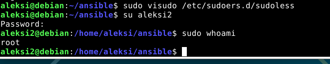

# H1 Voileipä

## Tiivistykset kappaleista
- käyttäjä luodaan komennolla "sudo adduser"
- Ryhmä luodaan komennolla "sudo groupadd"
- "sudo visudo /etc/sudoers.d/sudoless" ja "sinne %sudoless ALL = (ALL) NOPASSWD: ALL" antaa kaikkien sudoless ryhmän jäsenten käyttää sudoa ilman salasanaa.

## a) osa
Seurasin tehtävässä Tero karvinen "Sudo without password" ohjeita.

Menin terminaalissa ansible kansiooni komennolla "cd ansible/"
Siellä loin uuden käyttäjän komennolla "sudo adduser aleksi2"
Tein myös "sudoless" ryhmän komennolla "sudo groupadd sudoless"
lisäsin aleksi 2 sinne komennolla "sudo adduser aleksi2 sudoless".
Tämän jälkeen avasin uuden terminaali ikkunan ja kirjoitin sinne komennon "sudo -i" ja olin roottina sisällä.
Tämän jälkeen menin takaisin aiempaan terminaaliin, jossa olin kirjautuneena vielä sudona ja kirjoitin komennon "sudo visudo /etc/sudoers.d/sudoless" ja sinne lisäsin rivin tekstiä: "%sudoless ALL = (ALL) NOPASSWD: ALL"
Tämä lisäsi sudoers säännön, missä kaikki sudoless ryhmän käyttjät voivat käyttää sudoa ilman salasanaa.

## b) osa 
Tässä tehtävässä seurasin Tero Karvinen "Passwordles Sudo with Ansible" ohjeita.
Aluksi loin tiedoston mkdir -p roles/aleksi2/tasks
Tämän jälkeen komennolla "nano roles/aleksi2/tasks/main.yml
Ja lisäsin sinne ohjeiden mukaisesti. Muutin nimet aleksi2 ja key kohdan.  ylhäällä oleva kuva ohjeesta Tero Karvinen 2026 "Passwordles Sudo with Ansible".
Sitten menin "nano site.yml" ja sinne kohdan "hosts" alle kohdan "become: true" & "roles" kohtaan "aleksi2".
Tämän jälkeen ajoin terminaalissa komennon "ansible-playbook site.yml" ja tuli virhe ilmmoitus, jossa sanottiin, että sudo tarvitsee salasanan. 

Joten ajoin komennpn "ansible-playbook site.yml -K" ja syötin salasanan ja tämä oli lopputulos. 

## c) osa
Asensin kaksi pakettia seuraavaksi ansiblella. Nämä olivat tree ja htop. Lö

## Lähteet
Tero Karvinen 2026: Sudo without password: https://terokarvinen.com/passwordless-sudo/ Luettu 10.11.2026
Tero Karvinen 2026: Passwordless Sudo with Ansible: https://terokarvinen.com/passwordless-sudo-with-ansible/ Luettu 10.11.2026
Munroe 2006: xkcd Sandwich: https://xkcd.com/149/ Luettu 10.11.2026
